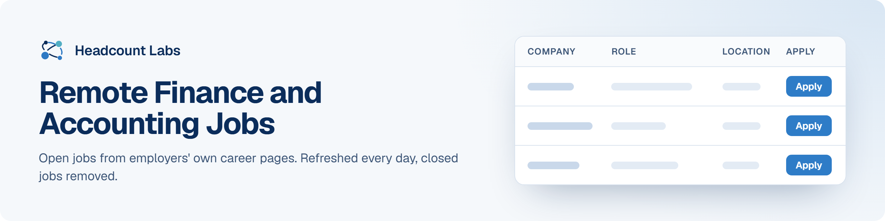

# Remote Finance and Accounting Jobs

Remote accounting, finance, tax, audit and payroll jobs at US employers.

**65 open jobs** · 25 new since the last update · 83 removed because they closed or left the employer's board · updated November 18, 2026 at 4:52 AM EST

This list is built and refreshed every day by [Headcount Labs](https://headcountlabs.com/?utm_source=github&utm_medium=job-list&utm_campaign=remote-finance-accounting-jobs), which reads jobs straight from employers' own career pages and job boards. Every job here was still listed on its source board when we last read that board, within the past 3 days, and was posted in the past 30 days. Copies of the same job are merged into one row, and jobs that close are removed at the next update.

Want this data in your own app or agent? Use the [Headcount Labs jobs API](https://headcountlabs.com/docs/?utm_source=github&utm_medium=job-list&utm_campaign=remote-finance-accounting-jobs) (free tier), the [MCP server](https://headcountlabs.com/mcp/?utm_source=github&utm_medium=job-list&utm_campaign=remote-finance-accounting-jobs) for Claude, ChatGPT and other AI assistants, or the [public dataset subsets](https://huggingface.co/HeadcountLabs) on Hugging Face (the full dataset is coming soon).

**Full dataset.** A bigger, one-off snapshot dated 2026-10-19 (all matching jobs, not only the open jobs below) is on Hugging Face: [Remote jobs](https://huggingface.co/datasets/HeadcountLabs/remote-jobs). It loads with `datasets.load_dataset` and is under the Open Database License (ODbL) 1.0.

**Jump to:** [Posted in the last 7 days (30)](#posted-in-the-last-7-days) · [Posted 8 to 30 days ago (35)](#posted-8-to-30-days-ago)

**Columns.** *Apply* opens the original posting on the employer's site. *Details* opens the job on Headcount Labs, with every posting we found for it. *Remote* shows what the employer states; a dash means the posting doesn't say. *Pay* is the range the employer published.

## Posted in the last 7 days

| Company | Role | Location | Remote | Pay | Posted | Apply | Details |
| --- | --- | --- | --- | --- | --- | :---: | :---: |
| **Bjak** | Product Engineer - AI Finance | United States | Remote | — | Nov 18 |  | <a href="https://headcountlabs.com/catalog/jobs/e35a3af7-dd61-47cb-92f2-3f1fd4cb4d76?utm_source=github&utm_medium=job-list&utm_campaign=remote-finance-accounting-jobs">via Headcount Labs</a> |
| **Bjak** | Mobile Developer - AI Finance Agent | United States | Remote | — | Nov 18 |  | <a href="https://headcountlabs.com/catalog/jobs/c1b4a2b1-ab4f-4db4-8215-cb7c046f0dec?utm_source=github&utm_medium=job-list&utm_campaign=remote-finance-accounting-jobs">via Headcount Labs</a> |
| **Bjak** | Android Developer - AI Finance Agent | United States | Remote | — | Nov 18 |  | <a href="https://headcountlabs.com/catalog/jobs/953f2434-45d2-4390-83f1-1ba417936184?utm_source=github&utm_medium=job-list&utm_campaign=remote-finance-accounting-jobs">via Headcount Labs</a> |
| **Bjak** | Mobile Engineer - AI Finance Agent | United States | Remote | — | Nov 18 |  | <a href="https://headcountlabs.com/catalog/jobs/5c944591-28fa-49f5-ae05-92507abdce59?utm_source=github&utm_medium=job-list&utm_campaign=remote-finance-accounting-jobs">via Headcount Labs</a> |
| **Bjak** | Technical Product Manager - AI Finance | United States | Remote | — | Nov 18 |  | <a href="https://headcountlabs.com/catalog/jobs/53ed1c42-8710-4780-8e04-2769431c50e1?utm_source=github&utm_medium=job-list&utm_campaign=remote-finance-accounting-jobs">via Headcount Labs</a> |
| **Bjak** | Mobile Application Developer - AI Finance Agent | United States | Remote | — | Nov 18 |  | <a href="https://headcountlabs.com/catalog/jobs/51bf5dc2-4a57-4b2c-900c-4d93f67a9ca9?utm_source=github&utm_medium=job-list&utm_campaign=remote-finance-accounting-jobs">via Headcount Labs</a> |
| **Bjak** | CEO - AI Finance | United States | Remote | — | Nov 18 |  | <a href="https://headcountlabs.com/catalog/jobs/4b802ad5-1973-47cc-8e6b-395f1231f4ab?utm_source=github&utm_medium=job-list&utm_campaign=remote-finance-accounting-jobs">via Headcount Labs</a> |
| **Bjak** | Backend Software Engineer - AI Finance Agent | United States | Remote | — | Nov 18 |  | <a href="https://headcountlabs.com/catalog/jobs/4b195dd3-0d90-45be-9c22-86b5053e1db6?utm_source=github&utm_medium=job-list&utm_campaign=remote-finance-accounting-jobs">via Headcount Labs</a> |
| **TriHealth, Inc.** | Financial Clearance Representative III | United States | Remote | — | Nov 17 |  | <a href="https://headcountlabs.com/catalog/jobs/46427424-a092-4def-b274-ad801e89b2ef?utm_source=github&utm_medium=job-list&utm_campaign=remote-finance-accounting-jobs">via Headcount Labs</a> |
| **SWCA Environmental Consultants** | Finance &amp; Risk Management Vice President | United States | Remote | $154k–$206k/yr | Nov 17 |  | <a href="https://headcountlabs.com/catalog/jobs/75b71a73-6fff-4047-b8d9-df95477fb673?utm_source=github&utm_medium=job-list&utm_campaign=remote-finance-accounting-jobs">via Headcount Labs</a> |
| **H&amp;R Block** | Senior Regulatory Tax Analyst | Missouri | Remote | $63k–$94k/yr | Nov 17 |  | <a href="https://headcountlabs.com/catalog/jobs/5f7d3ef7-913c-4eed-abb6-b148f46b098c?utm_source=github&utm_medium=job-list&utm_campaign=remote-finance-accounting-jobs">via Headcount Labs</a> |
| **General Dynamics Mission Systems, Inc** | Sr. Advanced Program Finance Specialist | United States | Remote | $115k/yr | Nov 17 |  | <a href="https://headcountlabs.com/catalog/jobs/62fd8891-ce35-417f-9fb5-c96863e831d2?utm_source=github&utm_medium=job-list&utm_campaign=remote-finance-accounting-jobs">via Headcount Labs</a> |
| **AbbVie** | Finance Planning Systems (SAP Analytics Cloud) | Chicago, IL | Remote | $110k–$208k/yr | Nov 17 |  | <a href="https://headcountlabs.com/catalog/jobs/79d483e1-436a-4ebe-88a9-6be8eac85aaa?utm_source=github&utm_medium=job-list&utm_campaign=remote-finance-accounting-jobs">via Headcount Labs</a> |
| **Terac** | Accounting Professionals: Interview on Reconciliation Workflows | United States | Remote | — | Nov 16 |  | <a href="https://headcountlabs.com/catalog/jobs/d73cb9ed-6abf-4285-9561-843f3f79f3f3?utm_source=github&utm_medium=job-list&utm_campaign=remote-finance-accounting-jobs">via Headcount Labs</a> |
| **Terac** | Finance and Operations Leaders: Interview on Reconciliation Infrastructure | United States | Remote | — | Nov 16 |  | <a href="https://headcountlabs.com/catalog/jobs/3ef22452-de5e-464a-9bd0-d675acd56e97?utm_source=github&utm_medium=job-list&utm_campaign=remote-finance-accounting-jobs">via Headcount Labs</a> |
| **Shady Grove Fertility** | Payroll and Tax Administrator Remote | ROCKVILLE, MD | Remote | $60k–$75k/yr | Nov 16 |  | <a href="https://headcountlabs.com/catalog/jobs/675eaa62-f07a-4cd8-b1a5-cdb07de91f97?utm_source=github&utm_medium=job-list&utm_campaign=remote-finance-accounting-jobs">via Headcount Labs</a> |
| **InnovAge** | SVP, Accounting | Denver, CO | Remote | — | Nov 16 |  | <a href="https://headcountlabs.com/catalog/jobs/184ef72e-d7ee-40f8-af47-5082f0179391?utm_source=github&utm_medium=job-list&utm_campaign=remote-finance-accounting-jobs">via Headcount Labs</a> |
| **GAI Consultants** | Project Accounting Associate II | Jacksonville, FL | Remote | — | Nov 16 |  | <a href="https://headcountlabs.com/catalog/jobs/3fda6cbd-0886-4dd7-add2-555f6e50a105?utm_source=github&utm_medium=job-list&utm_campaign=remote-finance-accounting-jobs">via Headcount Labs</a> |
| **MRO Corporation** | Payroll Specialist | United States | Remote | $19–$27/hr | Nov 15 |  | <a href="https://headcountlabs.com/catalog/jobs/6776bc6a-bcab-45e0-8305-6985d763d0f4?utm_source=github&utm_medium=job-list&utm_campaign=remote-finance-accounting-jobs">via Headcount Labs</a> |
| **HPE** | Principal Architect Financial Services | All, CT | Remote | — | Nov 15 |  | <a href="https://headcountlabs.com/catalog/jobs/521ad9d5-ed27-4c16-97a1-c3dfc4ff3166?utm_source=github&utm_medium=job-list&utm_campaign=remote-finance-accounting-jobs">via Headcount Labs</a> |
| **ASRC Federal Holding Company** | Financial Analyst | 

2 locations
North Carolina United States
 | Remote | — | Nov 15 |  | <a href="https://headcountlabs.com/catalog/jobs/507c3012-1269-434d-9bac-4af6e3bdfda9?utm_source=github&utm_medium=job-list&utm_campaign=remote-finance-accounting-jobs">via Headcount Labs</a> |
| **World Wide Technology** | Sr. Financial Analyst | Nationwide | Remote | $84k–$105k/yr | Nov 14 |  | <a href="https://headcountlabs.com/catalog/jobs/4f4155e1-16e5-4692-a98b-c6e05c96be5b?utm_source=github&utm_medium=job-list&utm_campaign=remote-finance-accounting-jobs">via Headcount Labs</a> |
| **ASRC Federal** | Financial Analyst | North Carolina | Remote | — | Nov 14 |  | <a href="https://headcountlabs.com/catalog/jobs/3240dd3f-b922-45f9-bf0d-a053c2c95cff?utm_source=github&utm_medium=job-list&utm_campaign=remote-finance-accounting-jobs">via Headcount Labs</a> |
| **Pearson** | Specialist, Production Planner (Financial Operations) | United States | Remote | $62k–$70k/yr | Nov 13 |  | <a href="https://headcountlabs.com/catalog/jobs/7786c583-7173-49ac-92af-837d61fb0d2d?utm_source=github&utm_medium=job-list&utm_campaign=remote-finance-accounting-jobs">via Headcount Labs</a> |
| **Public Consulting Group** | Payroll Specialist 1 | United States | Remote | $68k–$78k/yr | Nov 12 |  | <a href="https://headcountlabs.com/catalog/jobs/10e6ccf1-6922-4e82-ac9f-9df980a2b211?utm_source=github&utm_medium=job-list&utm_campaign=remote-finance-accounting-jobs">via Headcount Labs</a> |
| **Johns Hopkins University** | Research Training &amp; Education Manager (School of Medicine - Central Finance) - #Staff | Baltimore, MD | Remote | $75k–$132k/yr | Nov 12 |  | <a href="https://headcountlabs.com/catalog/jobs/4a25760e-e439-4765-881a-563e65159a08?utm_source=github&utm_medium=job-list&utm_campaign=remote-finance-accounting-jobs">via Headcount Labs</a> |
| **Ediphi** | Finance Associate | United States | Remote | — | Nov 12 |  | <a href="https://headcountlabs.com/catalog/jobs/f919b06f-5f6a-4d44-9780-48e4c1f43863?utm_source=github&utm_medium=job-list&utm_campaign=remote-finance-accounting-jobs">via Headcount Labs</a> |
| **Convergent Research** | Staff Accountant | United States | Remote | $115k/yr | Nov 12 |  | <a href="https://headcountlabs.com/catalog/jobs/3324f65c-e302-48e9-b6e1-e3bb2863deba?utm_source=github&utm_medium=job-list&utm_campaign=remote-finance-accounting-jobs">via Headcount Labs</a> |
| **US Foods** | Indirect Tax Analyst II (100% Virtual Remote) | 

33 locations
Altoona, PA Maryland Buffalo, NY Pittston, PA Loveland, CO Fishers, IN Perth Amboy, NJ Alcoa, TN Norwich, CT Norcross, GA Memphis, TN Cincinnati, OH +21 more
 | Remote | $55k–$90k/yr | Nov 11 |  | <a href="https://headcountlabs.com/catalog/jobs/27aa9960-f7fb-4f1b-a236-b4b0d708c3f3?utm_source=github&utm_medium=job-list&utm_campaign=remote-finance-accounting-jobs">via Headcount Labs</a> |
| **Johns Hopkins University** | Sr. Grants &amp; Contracts Analyst, Post Award (Research Finance) - #Staff | Baltimore, MD | Remote | $64k–$113k/yr | Nov 11 |  | <a href="https://headcountlabs.com/catalog/jobs/d4a44fb5-3b43-408e-9a7a-1967eca36203?utm_source=github&utm_medium=job-list&utm_campaign=remote-finance-accounting-jobs">via Headcount Labs</a> |

## Posted 8 to 30 days ago

| Company | Role | Location | Remote | Pay | Posted | Apply | Details |
| --- | --- | --- | --- | --- | --- | :---: | :---: |
| **Curtiss-Wright Corporation** | Program Financial Analyst | United States | Remote | $99k–$132k/yr | Nov 10 |  | <a href="https://headcountlabs.com/catalog/jobs/58eeb520-4238-4ec3-b4dd-a5c4cd4d49a5?utm_source=github&utm_medium=job-list&utm_campaign=remote-finance-accounting-jobs">via Headcount Labs</a> |
| **Affirm** | Accounting Manager | United States | Remote | $145k–$205k/yr | Nov 9 |  | <a href="https://headcountlabs.com/catalog/jobs/8b31da58-830a-4a25-be82-3f454d59f54a?utm_source=github&utm_medium=job-list&utm_campaign=remote-finance-accounting-jobs">via Headcount Labs</a> |
| **BMO Financial Group** | Associate Financial Advisor | Wisconsin | Remote | $55k–$110k/yr | Nov 7 |  | <a href="https://headcountlabs.com/catalog/jobs/be977995-3a42-49e8-972e-cd6402fa525b?utm_source=github&utm_medium=job-list&utm_campaign=remote-finance-accounting-jobs">via Headcount Labs</a> |
| **National Laboratory of the Rockies** | Accounts Receivable Project Staff Accountant | United States | Remote | $66k–$110k/yr | Nov 5 |  | <a href="https://headcountlabs.com/catalog/jobs/2226d64c-bc43-463b-915f-8840808b547f?utm_source=github&utm_medium=job-list&utm_campaign=remote-finance-accounting-jobs">via Headcount Labs</a> |
| **Rankings.io** | Director of Financial Planning &amp; Analysis | St Louis | Remote | $140k–$170k/yr | Nov 4 |  | <a href="https://headcountlabs.com/catalog/jobs/13bfa365-4f50-4863-af1d-243ad29d5f29?utm_source=github&utm_medium=job-list&utm_campaign=remote-finance-accounting-jobs">via Headcount Labs</a> |
| **Builders FirstSource** | Manager- IT Data Analytics (Financial Analytics) | United States | Remote | — | Nov 4 |  | <a href="https://headcountlabs.com/catalog/jobs/9caa502a-9ea0-4e00-a9e4-a90eac231498?utm_source=github&utm_medium=job-list&utm_campaign=remote-finance-accounting-jobs">via Headcount Labs</a> |
| **Western Computer** | Microsoft Dynamics 365 F&amp;SCM Senior Consultant - Finance | Oxnard | Remote | $110k–$150k/yr | Nov 3 |  | <a href="https://headcountlabs.com/catalog/jobs/ab92223c-d21f-4e6d-9a5f-5eed621e211a?utm_source=github&utm_medium=job-list&utm_campaign=remote-finance-accounting-jobs">via Headcount Labs</a> |
| **UMB Bank** | Fund Accountant - CLO | 

52 locations
Salt Lake City, UT Sacramento, CA Jefferson City, MO Washington, DC Bismarck, ND Austin, TX Phoenix, AZ Baton Rouge, LA Carson City, NV Lincoln, NE Topeka, KS Augusta, ME +40 more
 | Remote | $68k–$100k/yr | Nov 3 |  | <a href="https://headcountlabs.com/catalog/jobs/7705db9f-b19a-4b18-96a7-0ad752802906?utm_source=github&utm_medium=job-list&utm_campaign=remote-finance-accounting-jobs">via Headcount Labs</a> |
| **Terac** | Finance and Accounting Professionals: Business Operations and Software Workflows | United States | Remote | — | Nov 3 |  | <a href="https://headcountlabs.com/catalog/jobs/2e5f9d44-d92c-4177-8921-e9a415be9a15?utm_source=github&utm_medium=job-list&utm_campaign=remote-finance-accounting-jobs">via Headcount Labs</a> |
| **Orbia** | Senior Payroll Analyst &amp; Administrator | Tennessee | Remote | $77k–$86k/yr | Nov 3 |  | <a href="https://headcountlabs.com/catalog/jobs/27bdc599-3d2e-4a30-8598-b913f18a2d62?utm_source=github&utm_medium=job-list&utm_campaign=remote-finance-accounting-jobs">via Headcount Labs</a> |
| **Murdock Martell** | Accountant | 

2 locations
San Francisco, CA Sacramento, CA
 | Remote | $77k–$94k/yr | Nov 3 |  | <a href="https://headcountlabs.com/catalog/jobs/3078878f-bb2c-4647-a070-e67a402cfb50?utm_source=github&utm_medium=job-list&utm_campaign=remote-finance-accounting-jobs">via Headcount Labs</a> |
| **Genea** | Human Resources &amp; Payroll Specialist | Irvine, CA | Remote | $33–$40/hr | Nov 2 |  | <a href="https://headcountlabs.com/catalog/jobs/bae15ff5-d8dc-45dc-9cf7-f0a4e1d261a1?utm_source=github&utm_medium=job-list&utm_campaign=remote-finance-accounting-jobs">via Headcount Labs</a> |
| **Altius Search Group** | Large Ticket - Credit Analyst - Equipment Finance | 

28 locations
Phoenix, AZ Atlanta, GA Austin, TX Baltimore, MD Beaverton, OR Bend, OR Boston, MA Irvine, CA Cedar Rapids, IA Chicago, IL Cincinatti, OH Dallas, TX +16 more
 | Remote | $90k–$105k/yr | Nov 1 |  | <a href="https://headcountlabs.com/catalog/jobs/4450c145-e2f6-4ad7-a1f1-ce2bd4a83fe0?utm_source=github&utm_medium=job-list&utm_campaign=remote-finance-accounting-jobs">via Headcount Labs</a> |
| **Curtiss-Wright Corporation** | Cost Accountant, Lead | 

3 locations
Santa Clara, CA Santa Clarita, CA United States
 | Remote | $99k–$130k/yr | Oct 31 |  | <a href="https://headcountlabs.com/catalog/jobs/71a43830-9a47-4cca-bf0f-abfdb2f10070?utm_source=github&utm_medium=job-list&utm_campaign=remote-finance-accounting-jobs">via Headcount Labs</a> |
| **Marketbridge** | Specialist, Client Finance | Waterloo | Remote | $65k–$78k/yr | Oct 30 |  | <a href="https://headcountlabs.com/catalog/jobs/e48c49fb-0fd7-49a1-b1ab-512fab552072?utm_source=github&utm_medium=job-list&utm_campaign=remote-finance-accounting-jobs">via Headcount Labs</a> |
| **H&amp;R Block** | Seasonal, Virtual Tax Professional | Missouri | Remote | $21.59–$32.40/hr | Oct 30 |  | <a href="https://headcountlabs.com/catalog/jobs/e20edf47-f78e-4cc2-82a2-62869101a4d9?utm_source=github&utm_medium=job-list&utm_campaign=remote-finance-accounting-jobs">via Headcount Labs</a> |
| **Cupertino Electric** | Payroll- Union Reporting Specialist | 

2 locations
United States San Jose, CA
 | Remote | $57k–$106k/yr | Oct 30 |  | <a href="https://headcountlabs.com/catalog/jobs/6bf02820-0f53-4180-98f2-eb61b3970fe0?utm_source=github&utm_medium=job-list&utm_campaign=remote-finance-accounting-jobs">via Headcount Labs</a> |
| **Warner Music Group** | Sr. Accountant II | New York, NY | Remote | $90k–$95k/yr | Oct 29 |  | <a href="https://headcountlabs.com/catalog/jobs/b49dd337-ef34-4296-869f-edad47ccb0f3?utm_source=github&utm_medium=job-list&utm_campaign=remote-finance-accounting-jobs">via Headcount Labs</a> |
| **Vituity** | Senior Business Intelligence Engineer, Finance - Remote - Nationwide | Sacramento, CA | Remote | $109k–$140k/yr | Oct 29 |  | <a href="https://headcountlabs.com/catalog/jobs/275f4e78-6f5d-4ce6-92b0-b60a758b6859?utm_source=github&utm_medium=job-list&utm_campaign=remote-finance-accounting-jobs">via Headcount Labs</a> |
| **Reyes Holdings** | Route Accounting Associate | Huntington Beach, CA | Remote | — | Oct 27 |  | <a href="https://headcountlabs.com/catalog/jobs/7eb11b90-348c-4fe0-8abf-f075d8b60e67?utm_source=github&utm_medium=job-list&utm_campaign=remote-finance-accounting-jobs">via Headcount Labs</a> |
| **Pie Insurance** | GAAP Accountant | United States | Remote | $65k–$80k/yr | Oct 27 |  | <a href="https://headcountlabs.com/catalog/jobs/70106251-20d8-4d86-ba48-5c02e494dfbf?utm_source=github&utm_medium=job-list&utm_campaign=remote-finance-accounting-jobs">via Headcount Labs</a> |
| **Reyes Holdings** | Accounting Manager | Rosemont, IL | Remote | — | Oct 23 |  | <a href="https://headcountlabs.com/catalog/jobs/4266a322-a1ce-46ba-a530-0ec772cbbbfe?utm_source=github&utm_medium=job-list&utm_campaign=remote-finance-accounting-jobs">via Headcount Labs</a> |
| **H&amp;R Block** | Financial Services Operations Analyst | Missouri | Remote | $63k–$94k/yr | Oct 23 |  | <a href="https://headcountlabs.com/catalog/jobs/908afa0a-5b8d-4af6-b19e-49d10acb816e?utm_source=github&utm_medium=job-list&utm_campaign=remote-finance-accounting-jobs">via Headcount Labs</a> |
| **Principal Financial Group** | Financial Consultant I – Principal Connection | 

21 locations
Chicago, IL Minneapolis, MN Phoenix, AZ Austin, TX Jacksonville, FL Orlando, FL Dallas, TX Grand Island, NE Raleigh, NC Des Moines, IA Tampa, FL Salt Lake City, UT +9 more
 | Remote | $26.83–$38.61/hr | Oct 22 |  | <a href="https://headcountlabs.com/catalog/jobs/f5795150-2bd0-4659-a83a-ae4d192caee2?utm_source=github&utm_medium=job-list&utm_campaign=remote-finance-accounting-jobs">via Headcount Labs</a> |
| **Guthrie** | Sr Decision Support Analyst - Finance - Full Time | United States | Remote | — | Oct 22 |  | <a href="https://headcountlabs.com/catalog/jobs/7a6a5837-4a46-444b-8b34-96bc247173e5?utm_source=github&utm_medium=job-list&utm_campaign=remote-finance-accounting-jobs">via Headcount Labs</a> |
| **Circana** | Senior Financial Analyst | United States | Remote | $80k–$100k/yr | Oct 22 |  | <a href="https://headcountlabs.com/catalog/jobs/9ffda910-f393-429e-b000-eef4b6fd0c1a?utm_source=github&utm_medium=job-list&utm_campaign=remote-finance-accounting-jobs">via Headcount Labs</a> |
| **US Tech Solutions** | Coordinator, Payroll Tax and Accounting # 26-26346 | Kentucky | Remote | $22–$23/hr | Oct 21 |  | <a href="https://headcountlabs.com/catalog/jobs/5cdbf786-9365-452f-bfc6-b52f244c04ad?utm_source=github&utm_medium=job-list&utm_campaign=remote-finance-accounting-jobs">via Headcount Labs</a> |
| **SimonMed Imaging** | Revenue Cycle Reconciliation &amp; Audit Specialist | United States | Remote | — | Oct 21 |  | <a href="https://headcountlabs.com/catalog/jobs/b7467745-661c-4e34-9752-e28d23951cc7?utm_source=github&utm_medium=job-list&utm_campaign=remote-finance-accounting-jobs">via Headcount Labs</a> |
| **Pegasystems** | Client Executive - Financial Services | 

5 locations
New York, NY New Jersey Atlanta, GA West Palm Beach, FL Tampa, FL
 | Remote | $131k–$200k/yr | Oct 21 |  | <a href="https://headcountlabs.com/catalog/jobs/dce2a7f5-405d-4d20-a2a3-32423f5c4c23?utm_source=github&utm_medium=job-list&utm_campaign=remote-finance-accounting-jobs">via Headcount Labs</a> |
| **Sprinklr** | Senior Manager, Revenue Accounting &amp; Advisory | 

49 locations
Virginia Austin, VA Massachusetts Austin, MA New Jersey Austin, NJ Maine Austin, ME United States Illinois Austin, IL Michigan +37 more
 | Remote | $121k–$201k/yr | Oct 20 |  | <a href="https://headcountlabs.com/catalog/jobs/3e36cd77-5218-46c2-bb3b-542c646a020a?utm_source=github&utm_medium=job-list&utm_campaign=remote-finance-accounting-jobs">via Headcount Labs</a> |
| **SAIC** | Financial Analyst | Ashburn, VA | Remote | $60k–$100k/yr | Oct 20 |  | <a href="https://headcountlabs.com/catalog/jobs/a7e3ca81-dc5e-497f-9e16-7b004fb23a9b?utm_source=github&utm_medium=job-list&utm_campaign=remote-finance-accounting-jobs">via Headcount Labs</a> |
| **Nelnet** | Global Payroll Manager | 

3 locations
United States Centennial, CO Mississauga
 | Remote | $90k/yr | Oct 20 |  | <a href="https://headcountlabs.com/catalog/jobs/85bb9d45-3a77-4899-a30d-bf7179fd4dff?utm_source=github&utm_medium=job-list&utm_campaign=remote-finance-accounting-jobs">via Headcount Labs</a> |
| **H&amp;R Block** | Tax Research Specialist, Seasonal | Missouri | Remote | $21.59–$32.40/hr | Oct 20 |  | <a href="https://headcountlabs.com/catalog/jobs/e6fa1b58-c760-499a-84e7-78cbf82905a9?utm_source=github&utm_medium=job-list&utm_campaign=remote-finance-accounting-jobs">via Headcount Labs</a> |
| **H&amp;R Block** | Tax Research Representative, Seasonal | Missouri | Remote | $18.41–$27.64/hr | Oct 20 |  | <a href="https://headcountlabs.com/catalog/jobs/0d425087-70d6-4b4b-927d-7817ca24f6b3?utm_source=github&utm_medium=job-list&utm_campaign=remote-finance-accounting-jobs">via Headcount Labs</a> |
| **Gopuff** | Senior Oracle Business Analyst, Finance | United States | Remote | $112k–$140k/yr | Oct 19 |  | <a href="https://headcountlabs.com/catalog/jobs/e4f9bc31-2502-47a4-bcc5-c89b39a40c8e?utm_source=github&utm_medium=job-list&utm_campaign=remote-finance-accounting-jobs">via Headcount Labs</a> |

## Related data on Headcount Labs

- [Accountant salary data from posted pay](https://headcountlabs.com/salary-data/accountant/)
- [Financial analyst job postings dataset](https://headcountlabs.com/data/financial-analyst-job-postings/)
- [US job market report: open jobs by state, top employers, pay and remote share](https://headcountlabs.com/reports/us-job-market/)

## More lists from Headcount Labs

[Software Engineering Internships](https://github.com/HeadcountLabs/software-engineering-internships) · [Data Science, AI and Machine Learning Internships](https://github.com/HeadcountLabs/data-science-ai-internships) · [Engineering Internships](https://github.com/HeadcountLabs/engineering-internships) · [Business, Finance and Marketing Internships](https://github.com/HeadcountLabs/business-finance-internships) · [Internships in the US](https://github.com/HeadcountLabs/internships) · [New Grad Software Engineer Jobs](https://github.com/HeadcountLabs/new-grad-software-engineer-jobs) · [Entry-Level and New Grad Jobs](https://github.com/HeadcountLabs/entry-level-jobs) · [Entry-Level Data Analyst Jobs](https://github.com/HeadcountLabs/entry-level-data-analyst-jobs) · [Remote Software Engineer Jobs](https://github.com/HeadcountLabs/remote-software-engineer-jobs) · [Remote Data, AI and Machine Learning Jobs](https://github.com/HeadcountLabs/remote-data-jobs) · [Remote Product Manager Jobs](https://github.com/HeadcountLabs/remote-product-manager-jobs) · [Remote Marketing Jobs](https://github.com/HeadcountLabs/remote-marketing-jobs) · [Remote Sales Jobs](https://github.com/HeadcountLabs/remote-sales-jobs) · [Remote Customer Support and Success Jobs](https://github.com/HeadcountLabs/remote-customer-support-jobs) · [Remote Healthcare Jobs](https://github.com/HeadcountLabs/remote-healthcare-jobs) · [Remote Jobs in the US](https://github.com/HeadcountLabs/remote-jobs) · [AI and Machine Learning Engineer Jobs](https://github.com/HeadcountLabs/ai-ml-engineer-jobs) · [Data Engineer Jobs](https://github.com/HeadcountLabs/data-engineer-jobs) · [Cybersecurity Jobs](https://github.com/HeadcountLabs/cybersecurity-jobs) · [Product Manager Jobs](https://github.com/HeadcountLabs/product-manager-jobs) · [Registered Nurse Jobs](https://github.com/HeadcountLabs/registered-nurse-jobs) · [Software Jobs Paying $200k+](https://github.com/HeadcountLabs/high-paying-software-jobs) · [Tech and Software Jobs in the US](https://github.com/HeadcountLabs/tech-jobs) · [Jobs with Salary Listed in the US](https://github.com/HeadcountLabs/pay-transparency-jobs) · [San Francisco Bay Area Tech Jobs](https://github.com/HeadcountLabs/bay-area-tech-jobs) · [New York City Tech Jobs](https://github.com/HeadcountLabs/new-york-tech-jobs) · [Seattle Tech Jobs](https://github.com/HeadcountLabs/seattle-tech-jobs) · [Austin Tech Jobs](https://github.com/HeadcountLabs/austin-tech-jobs) · [Boston Tech Jobs](https://github.com/HeadcountLabs/boston-tech-jobs) · [Los Angeles Tech Jobs](https://github.com/HeadcountLabs/los-angeles-tech-jobs) · [Washington, DC Tech Jobs](https://github.com/HeadcountLabs/washington-dc-tech-jobs)

## Contributing

This README is generated, so edits to it are overwritten at the next update. If a job is closed, a link is broken or a detail is wrong, [open an issue](../../issues/new) with the link and we'll fix it in the data, which fixes it everywhere. Requests for new lists are welcome too.

## License

The list data is under the [Open Database License (ODbL) 1.0](LICENSE). Our own values in it are under the [Database Contents License (DbCL) 1.0](https://opendatacommons.org/licenses/dbcl/1-0/). Credit "Headcount Labs (https://headcountlabs.com)" when you reuse it. Job description text is the employer's own text and is not licensed by us. Takedown requests: [https://headcountlabs.com/remove/](https://headcountlabs.com/remove/). Location data includes data from OpenStreetMap contributors (ODbL) and Overture Maps. The same rows are in [`data/jobs.csv`](data/jobs.csv).

Generated by Headcount Labs from the jobs API on November 18, 2026 at 4:52 AM EST. At most 8 jobs per employer are shown in each list.
